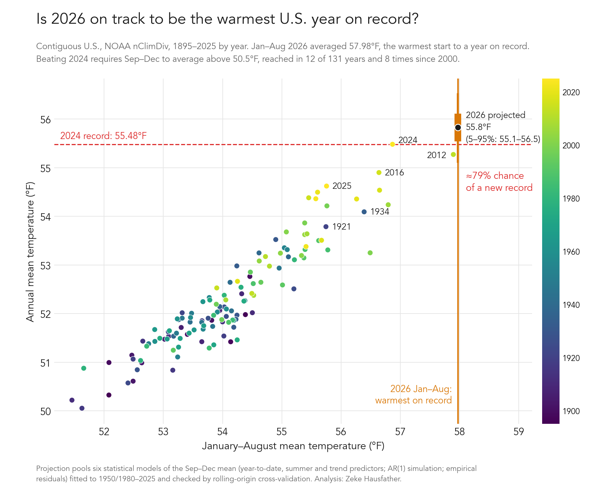

# Is 2026 on track to be the warmest year on record for the contiguous U.S.?

**Short answer: probably. Using NOAA's monthly data through August 2026, a set of simple
statistical models gives roughly an 80% chance (range across models: about 65–87%) that 2026
finishes as the warmest year in the 132-year contiguous U.S. record, and about a 90% chance it
finishes in the top two.**



Analysis by [Zeke Hausfather](https://www.theclimatebrink.com/), 1 October 2026. Data through
August 2026; the numbers will shift once NOAA publishes September. Full details, including
cross-validation results and caveats, are in [METHODS.md](METHODS.md).

## Key numbers

All values are contiguous U.S. (CONUS) average temperatures from NOAA's
[Climate at a Glance](https://www.ncei.noaa.gov/access/monitoring/climate-at-a-glance/national/time-series)
(nClimDiv), in °F, with °C in brackets.

| Quantity | Value |
|---|---|
| January–August 2026 mean | 57.98 °F (14.43 °C), warmest January–August on record; 4.13 °F above the 20th-century average |
| Previous warmest January–August | 2012, 57.90 °F |
| Current annual record | 2024, 55.48 °F (13.04 °C) |
| Runner-up | 2012, 55.27 °F |
| September–December mean needed to beat 2024 | 50.50 °F (10.28 °C), about 2.2 °F above the 20th-century average for those months |
| September–December mean, 2016–2025 average | 50.96 °F, about 2.6 °F above the 20th-century average |
| Years when Sep–Dec exceeded 50.50 °F | 12 of 131, 8 of them since 2000 |
| Pooled projection for 2026 annual mean | 55.8 °F (13.2 °C), 5–95% range 55.1–56.5 °F |
| Probability 2026 beats 2024 | ~79% (model range 67–87%) |
| Probability 2026 finishes in the top two | ~90% |

NOAA's annual value is the unweighted mean of the 12 monthly values (checked to within
rounding), so the only unknown is the September–December mean. A 2012-style finish (Sep–Dec
of 50.03 °F) would leave 2026 in second place at 55.33 °F.

## How the odds were estimated

Six statistical models predict the September–December mean from what is already known, and the
annual value follows arithmetically:

1. Regression of Sep–Dec on the January–August mean plus a warming trend.
2. The same with the June–August mean added as a predictor (recent months carry a little extra information).
3. and 4. Versions of 1 and 2 with a trend that steepens after 1980.
5. A simple month-to-month persistence (AR(1)) model simulated forward from the observed August anomaly.
6. The trend value plus the last 30 years of observed Sep–Dec departures from trend.

Each model was tested by rolling-origin cross-validation (predicting each year 2000–2025 using
only earlier years). Models fitted with a single linear trend from 1895 or 1950 under-predict
recent autumns by 0.5–1 °F, because U.S. warming has accelerated, so the headline pools only the
models that proved unbiased with properly sized uncertainty ranges. The spread of the pooled
models is a fair representation of the structural uncertainty; see METHODS.md for the full
tables.

What the estimate does not use: seasonal forecasts (such as NOAA CPC outlooks) or the current
El Niño state. Historically El Niño has a mixed-sign and small effect on the CONUS annual mean.

## Reproducing

```sh
pip install -r requirements.txt
./fetch_data.sh              # optional: refresh the NOAA series (data/ holds the 1 Oct 2026 snapshot)
python record_odds.py        # model fits, 2026 odds, cross-validation on 1980–2025
python cv2.py                # cross-validation on 2000–2025, hinge-trend models, hindcasts of 2012/2016/2024/2025
python make_figure.py        # pooled estimate, results/model_summary.csv, two-panel figure
python make_figure_simple.py # single-panel figure shown above
```

## Files

- `data/cag_all_months.csv`, `data/cag_annual.csv`: NOAA Climate at a Glance snapshots downloaded 1 October 2026.
- `figures/`: the single-panel figure above and a two-panel version that adds the full predictive distribution.
- `results/model_summary.csv`: per-model projections and probabilities.
- `METHODS.md`: data checks, model definitions, cross-validation and hindcast tables, caveats.

## License and data

Code is released under the MIT License. NOAA nClimDiv / Climate at a Glance data are in the
public domain as a U.S. Government work; please cite NOAA National Centers for Environmental
Information, Climate at a Glance: National Time Series, retrieved 1 October 2026, from
https://www.ncei.noaa.gov/access/monitoring/climate-at-a-glance/national/time-series.
